<div align="center">

# 🏋️ IronCore — Gym Management System

**A complete web-based system to run a gym: members, plans, subscriptions, class booking, personal training,
trainers, payments, attendance and an admin dashboard.**

Integrated semester project combining **Database Systems**, **Web Development** and **Software Engineering**.


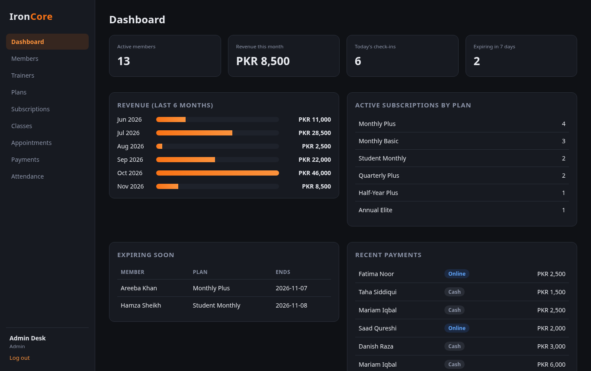

</div>

---

## 📌 The idea
Many local gyms still run on paper registers and WhatsApp messages: nobody knows exactly whose membership has expired,
classes get overbooked and cash payments are hard to track. IronCore puts the whole front desk in one place, with a
separate view for the **admin**, the **trainers** and the **members** themselves.

## ✨ Features

| Module | What it does |
|--------|--------------|
| 🔐 **Authentication & roles** | Login with bcrypt-hashed passwords; three roles (admin / trainer / member) with server-side access checks |
| 👥 **Members** | Register, edit, search, deactivate, delete; emergency contact; current plan shown in the list |
| 📦 **Plans** | Monthly / quarterly / yearly packages with price and availability |
| 🧾 **Subscriptions** | Sell a plan in one step (with payment), automatic end-date calculation, auto-expiry, paid / due status |
| 🗓️ **Class booking** | Weekly schedule, next-session date, live seat bars, capacity and double-booking protection |
| 🤝 **Personal training appointments** | Members request sessions; trainers confirm → complete; 60-minute clash detection |
| 🧑‍🏫 **Trainers** | Profiles, specialization, experience, number of classes and upcoming sessions |
| 💳 **Payments** | Cash and online (bank transfer / wallet with reference) — recorded, filterable by month & method |
| ✅ **Attendance** | Check-in / check-out (only with an active plan), visit duration, daily list |
| 📊 **Admin dashboard** | Active members, revenue this month, today's check-ins, expiring plans, 6-month revenue chart, recent payments |
| 🙋 **Member portal** | Own plan & days left, visits in 30 days, bookings, payments history |

> **Note on payments:** no real payment gateway is connected. "Online" payments are transfers made outside the system and
> recorded by staff with their reference number. No card data is ever stored.

## 🛠️ Tech stack
- **Back end:** PHP 8 (procedural, PDO with prepared statements)
- **Database:** MySQL 8 / MariaDB — 10 tables, foreign keys, CHECK & UNIQUE constraints, indexes, a reporting view
- **Front end:** HTML5 + hand-written CSS (dark theme, responsive, no framework)
- **Security:** password hashing, CSRF tokens on every form, output escaping, role checks, transactions
- **Docs:** SRS, use cases, user stories, ER and class diagrams (Mermaid, rendered by GitHub)

## 📁 Project structure
```
gym-management-system/
├── index.php              # login
├── dashboard.php          # role-based dashboard
├── members.php  trainers.php  plans.php  subscriptions.php
├── classes.php  appointments.php  payments.php  attendance.php
├── logout.php
├── config/database.php    # DB settings (XAMPP defaults, env overrides)
├── includes/              # db.php, auth.php, helpers.php, header.php, footer.php
├── assets/css/style.css
├── database/
│   ├── schema.sql         # tables, constraints, indexes, view
│   └── seed.sql           # demo data (dates relative to import day)
├── docs/                  # SRS, use cases, user stories, ER + class diagrams
└── screenshots/
```

## 🚀 How to run

### Option A — XAMPP (Windows)
1. Install [XAMPP](https://www.apachefriends.org/) and start **Apache** and **MySQL**.
2. Copy this folder to `C:\xampp\htdocs\gym-management-system`.
3. Open **phpMyAdmin** → *Import* → `database/schema.sql`, then import `database/seed.sql`.
4. Visit **http://localhost/gym-management-system/**

### Option B — PHP built-in server (Linux / macOS)
```bash
git clone https://github.com/Mo-aini/gym-management-system.git
cd gym-management-system
mysql -u root -p < database/schema.sql
mysql -u root -p < database/seed.sql
# defaults: root / empty password — override if needed
export GYM_DB_USER=root GYM_DB_PASS=yourpassword
php -S localhost:8000
```
Open **http://localhost:8000**

### Demo accounts
| Role | Email | Password |
|------|-------|----------|
| Admin | admin@ironcore.test | admin123 |
| Trainer | trainer@ironcore.test | trainer123 |
| Member | member@ironcore.test | member123 |

## 📸 Screenshots

| Login | Members |
|---|---|
| 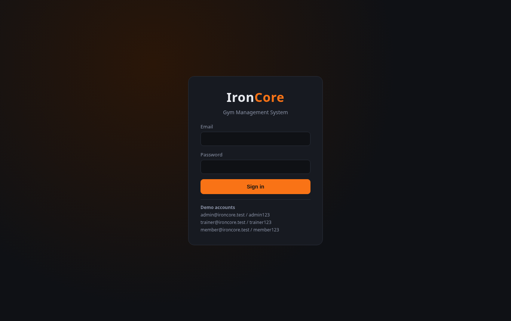 | 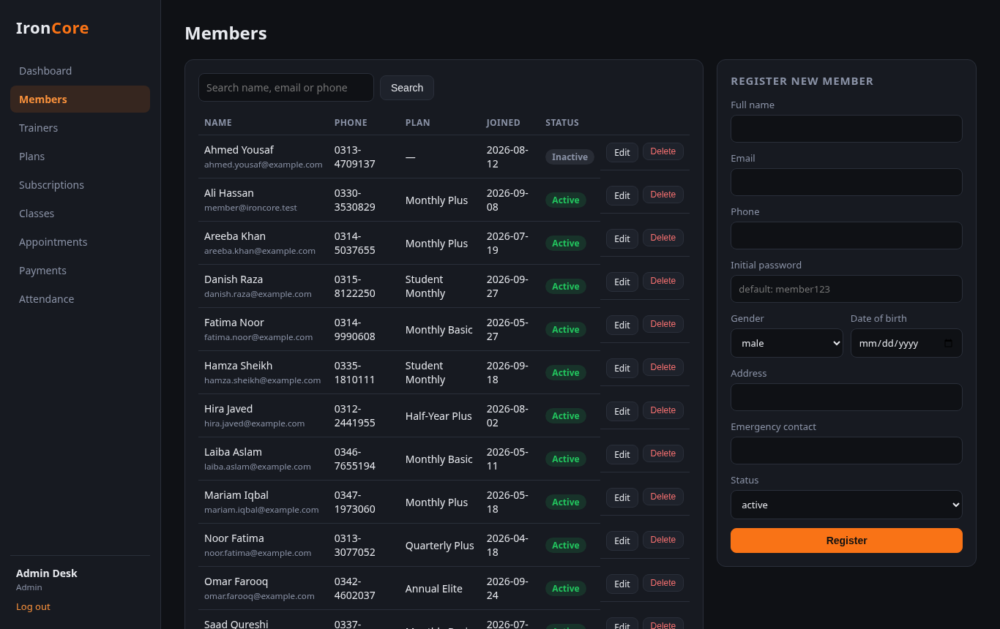 |
| **Subscriptions (paid / due)** | **Membership plans** |
| 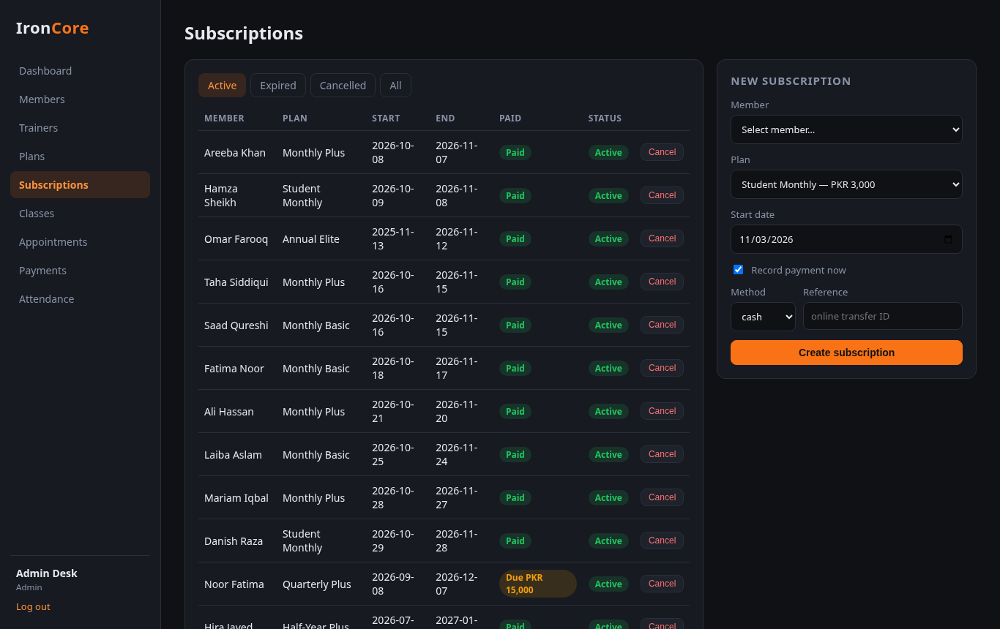 | 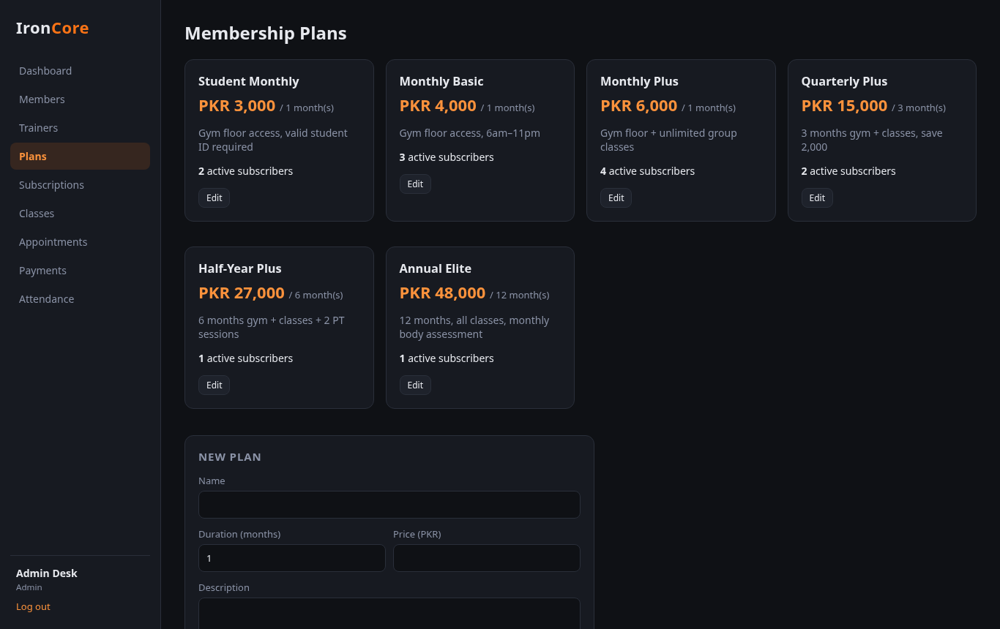 |
| **Class schedule (admin)** | **Payments (cash + online)** |
| 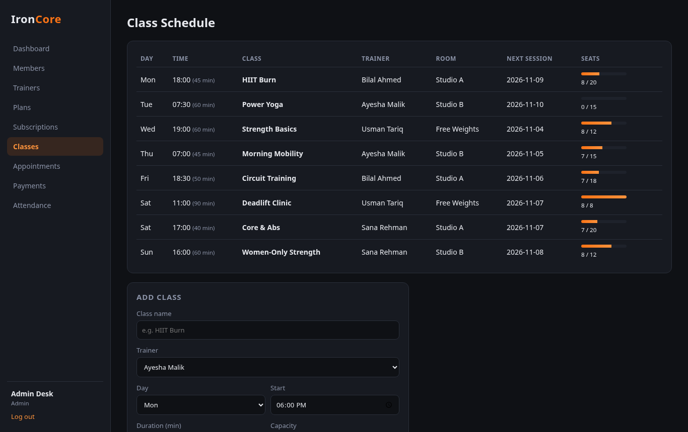 | 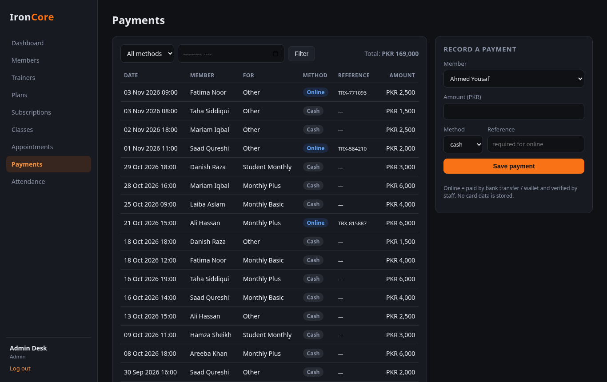 |
| **Attendance** | **Trainers** |
| 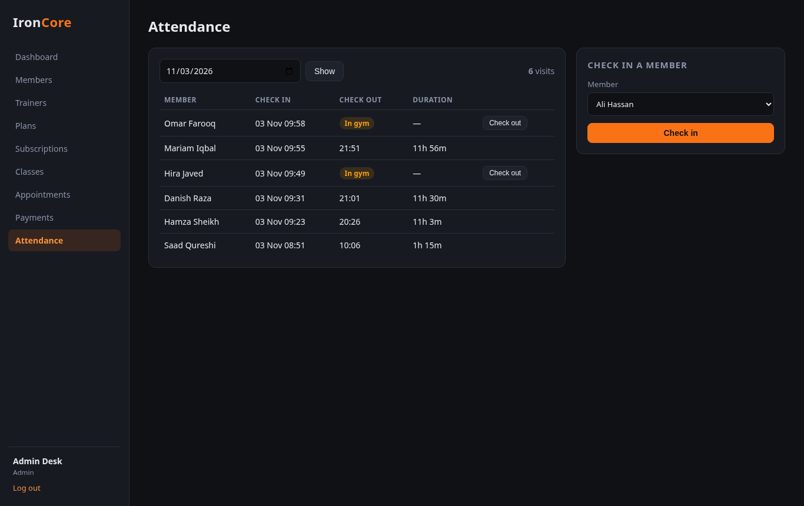 | 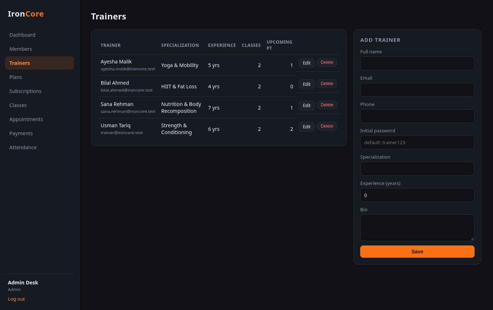 |
| **Trainer dashboard** | **Member dashboard** |
| 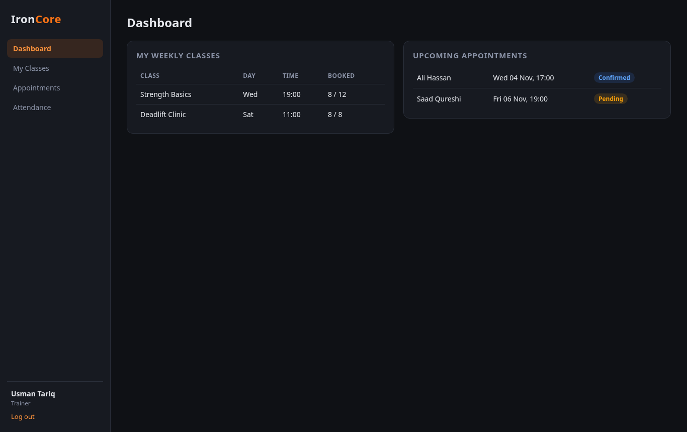 | 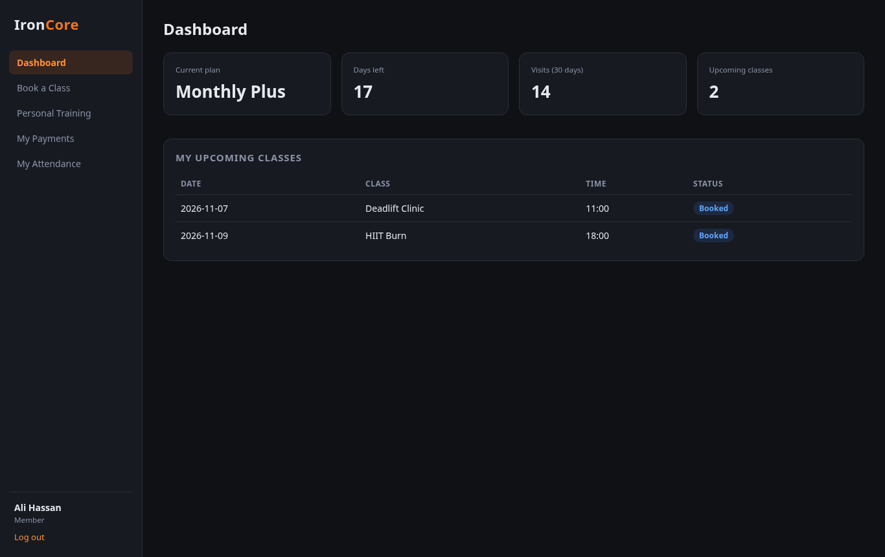 |
| **Member booking a class** | **PT appointments** |
| 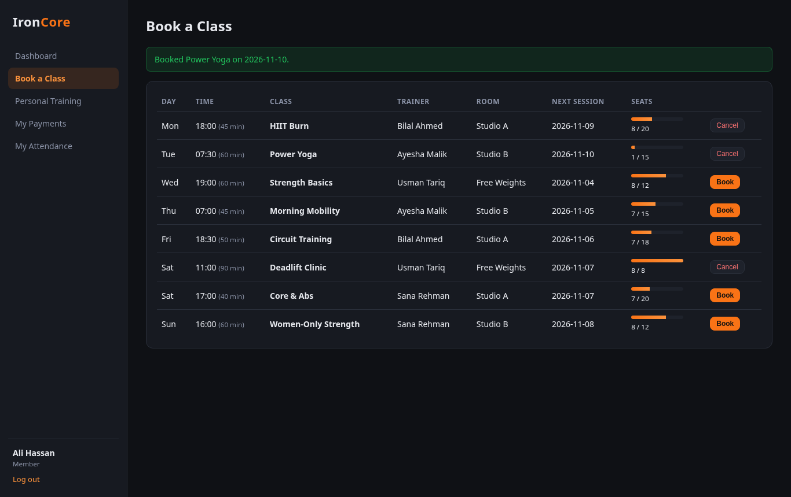 | 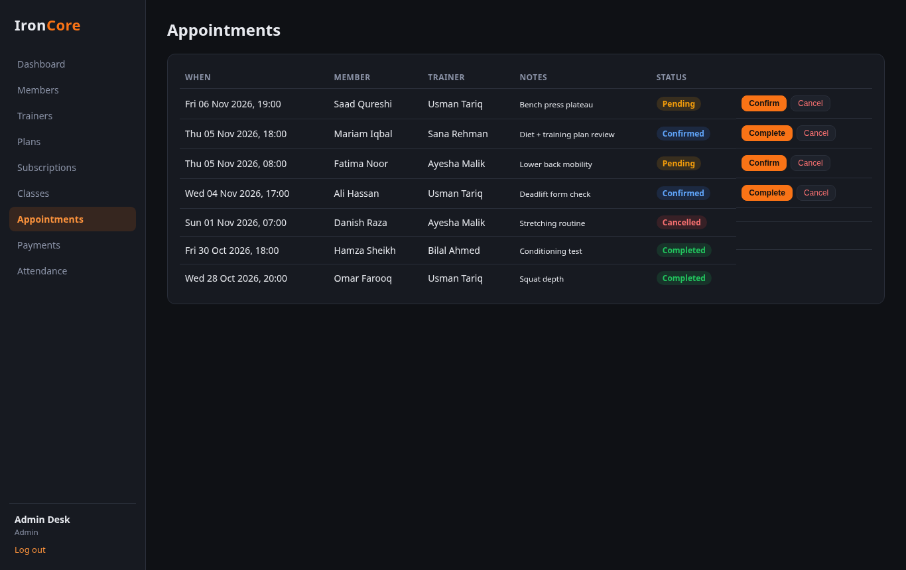 |

## 🗃️ Database design
10 tables: `users`, `members`, `trainers`, `plans`, `subscriptions`, `classes`, `bookings`, `appointments`,
`payments`, `attendance` + view `v_active_members`.
Full diagram and normalisation notes: **[docs/er-diagram.md](docs/er-diagram.md)**

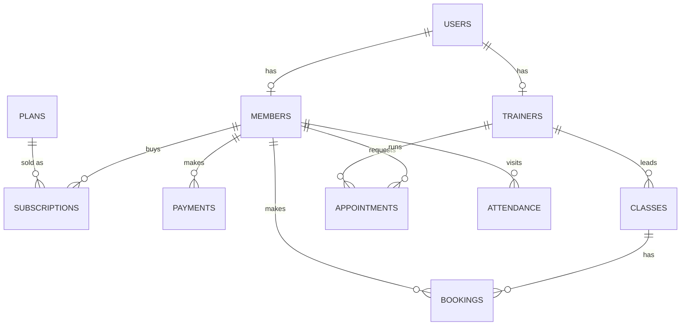

## 📚 Software engineering documents
- [Software Requirements Specification (SRS)](docs/SRS.md) — 20 functional + 9 non-functional requirements
- [Use cases](docs/use-cases.md) — use-case diagram and detailed flows
- [User stories](docs/user-stories.md) — acceptance criteria and prioritised backlog
- [ER diagram](docs/er-diagram.md) · [Class / module diagram](docs/class-diagram.md)

## ✅ Business rules implemented
- One active subscription per member (selling a new plan closes the old one)
- Subscriptions auto-expire after their end date
- Check-in and class booking require an active plan
- No overbooking (capacity) and no double booking (`UNIQUE` key)
- Trainers can't get two PT sessions within 60 minutes
- Online payments must carry a transaction reference

## 🧠 What I learned
- Designing a normalised relational schema from real requirements and enforcing rules in the database (FKs, UNIQUE, CHECK)
- Writing secure PHP: prepared statements, password hashing, CSRF protection, output escaping, role-based access
- Turning an SRS and user stories into working features and keeping documentation in sync with code
- Writing reporting queries (aggregations by month, date arithmetic, sub-queries) for a dashboard

## 🔮 Future improvements
Real payment gateway with webhooks · SMS/e-mail renewal reminders · QR self check-in · member progress tracking ·
REST API for a mobile app.

---

**Author:** Mohammed Emad ALaini — BS Software Engineering, Superior University, Lahore
Licensed under the [MIT License](LICENSE).
