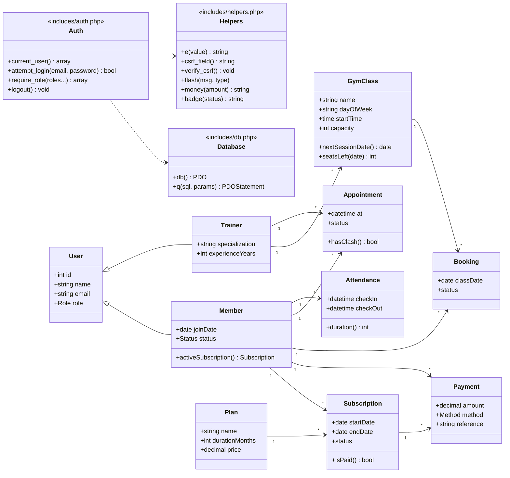

# Class / Module Diagram

The application is written in procedural PHP with a thin shared layer. The diagram shows the logical
design (each page is a controller + view for one module) and the domain model it works on.

## Page → module map
| Page | Roles | Responsibility |
|------|-------|----------------|
| `index.php` | public | Login form |
| `dashboard.php` | all | Role-specific dashboard |
| `members.php` | admin | Member CRUD + search |
| `trainers.php` | admin | Trainer CRUD |
| `plans.php` | admin | Plan CRUD |
| `subscriptions.php` | admin | Sell/cancel plans, auto-expire |
| `classes.php` | all | Schedule, booking, add class |
| `appointments.php` | all | PT requests and status workflow |
| `payments.php` | admin, member | Record and list payments |
| `attendance.php` | all | Check-in/out, visit history |
