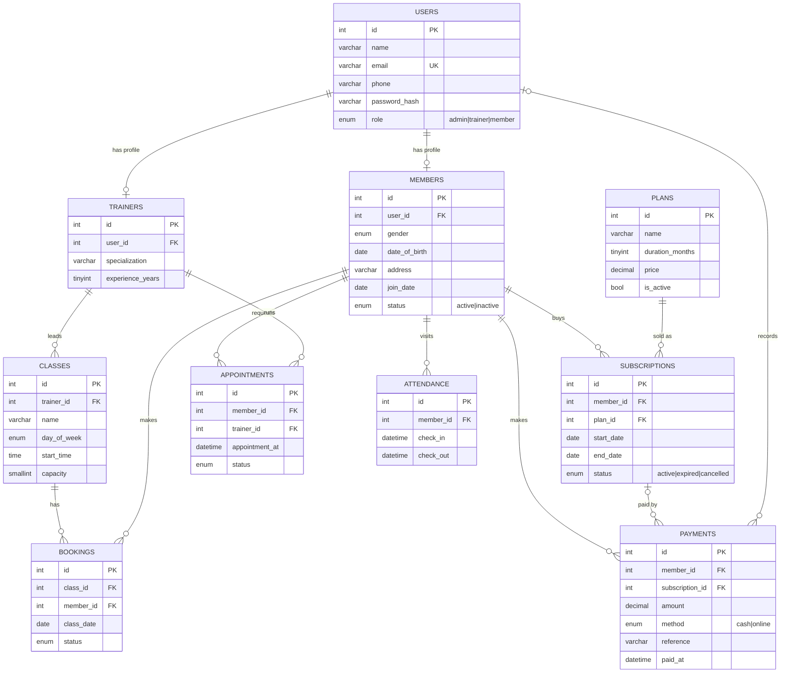

# Entity–Relationship Diagram

## Normalisation notes
- Login data lives once in `users`; role-specific data is split into `members` / `trainers` (1:1) — no repeated columns.
- `subscriptions` resolves the M:N between members and plans and keeps history (3NF: price is read from the plan,
  the amount actually paid lives in `payments`).
- `bookings` resolves the M:N between members and class sessions; `UNIQUE (class_id, member_id, class_date)` prevents double booking.
- Indexes: `subscriptions(status, end_date)` for the expiring list, `payments(paid_at)` for revenue reports,
  `attendance(check_in)` for daily lists, `appointments(trainer_id, appointment_at)` for clash checks.
