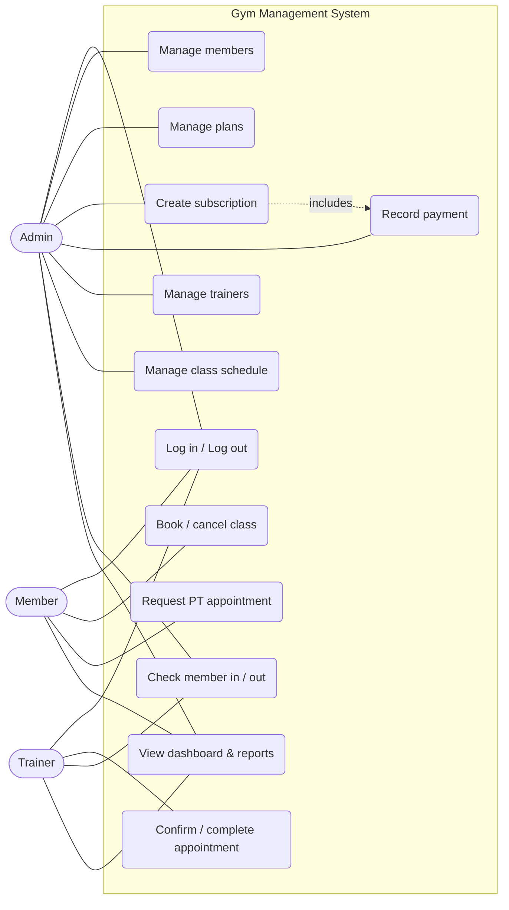

# Use Cases

## Use case diagram

## Detailed use cases

### UC4 — Create subscription
| Field | Description |
|-------|-------------|
| Actor | Admin |
| Precondition | Admin is logged in; member exists and is active; plan is available |
| Main flow | 1. Admin opens *Subscriptions*. 2. Selects member, plan and start date. 3. Optionally ticks *Record payment now* and chooses cash/online. 4. System calculates the end date (start + duration − 1 day). 5. System cancels the member's previous active subscription. 6. System saves the subscription (and payment) in one transaction and shows a confirmation. |
| Alternative flow | 3a. Online selected without a transaction reference → system refuses and asks for the reference (FR-08). |
| Postcondition | Member has exactly one active subscription |

### UC8 — Book a class
| Field | Description |
|-------|-------------|
| Actor | Member |
| Precondition | Member is logged in |
| Main flow | 1. Member opens *Book a Class*. 2. System lists the weekly schedule with the next session date and seats left. 3. Member clicks *Book*. 4. System checks: active subscription on that date, seats available, not already booked. 5. System saves the booking and shows "Booked <class> on <date>". |
| Exceptions | 4a. No active subscription → error message. 4b. Class full → "Sorry, this class is full". |
| Postcondition | Seat count for that session increases by one |

### UC9 — Request PT appointment
| Field | Description |
|-------|-------------|
| Actor | Member |
| Main flow | 1. Member chooses trainer, date/time and notes. 2. System checks the time is in the future and the trainer has no other session within 60 min. 3. System saves the appointment as *pending*. 4. Trainer later confirms or cancels (UC10). |
| Exceptions | 2a. Clash → "The trainer is already booked at that time". |

### UC11 — Check member in
| Field | Description |
|-------|-------------|
| Actor | Admin, Trainer |
| Main flow | 1. Staff selects member and clicks *Check in*. 2. System verifies an active subscription for today and that the member is not already inside. 3. System records check-in time. 4. Later staff clicks *Check out*; system stores the time and shows visit duration. |
| Exceptions | 2a. Expired plan → "No active subscription — please renew". |

### UC5 — Record payment
| Field | Description |
|-------|-------------|
| Actor | Admin |
| Main flow | 1. Admin opens *Payments*, selects member, amount and method. 2. For *online*, admin enters the bank/wallet transaction reference after verifying it. 3. System stores the payment with the recording user and timestamp. |
| Business rule | No card details are ever stored. The system records payments; it does not process them. |
